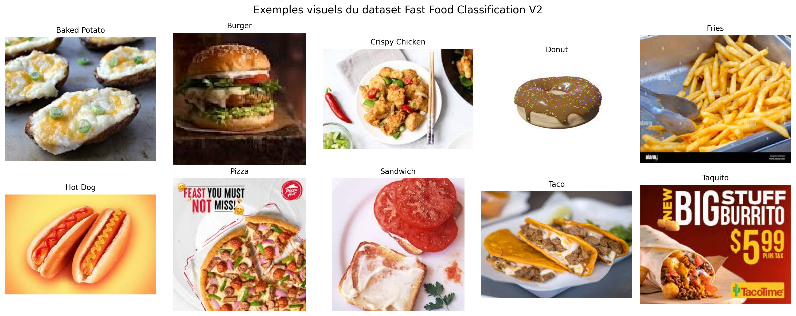
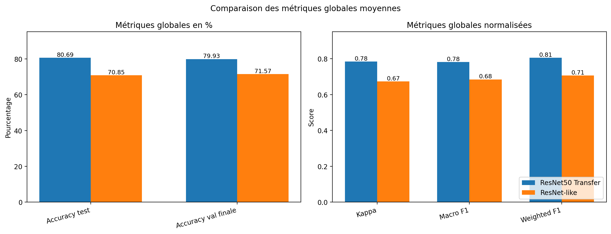
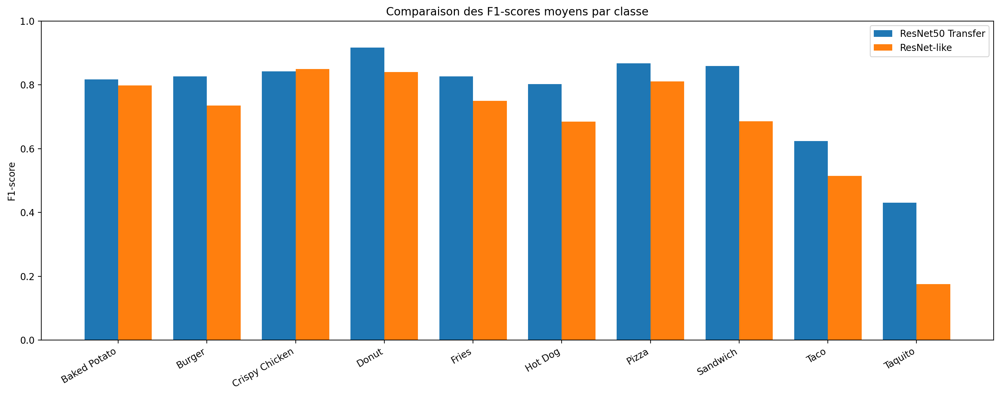

# Transfer Learning vs Custom CNN: Fast-Food Image Classification

> Head-to-head comparison of a pretrained ResNet50 (transfer learning) and a ResNet-like CNN trained from scratch, on a 10-class image dataset, averaged over 5 seeds.


Computer vision lab (TP3) by **Antoine Riom** and **Julien Excoffier**, March 2026.
The full write-up, in French, is in [REPORT.fr.md](REPORT.fr.md).

<p align="center">
  
</p>

## Results

Mean over 5 runs (same splits, 15 epochs each):

| Metric | ResNet50 transfer | Custom ResNet-like CNN |
|---|:---:|:---:|
| Test accuracy | **80.69%** ± 0.32 | 70.85% ± 0.34 |
| Cohen's kappa | **0.784** | 0.674 |
| Macro F1 | **0.781** | 0.685 |
| Training time (total) | **252 s** | 442 s |

Transfer learning wins by about 10 points, trains in roughly half the time and stays very stable across seeds. The custom CNN is still steady and learns well for a model trained from scratch, which makes the gap a fair measure of what pretraining brings.

| Global metrics | Per-class F1 |
|---|---|
|  |  |

## Dataset

[Fast Food Classification V2](https://www.kaggle.com/datasets/utkarshsaxenadn/fast-food-classification-dataset), downloaded automatically with `kagglehub`.
10 classes (Baked Potato, Burger, Crispy Chicken, Donut, Fries, Hot Dog, Pizza, Sandwich, Taco, Taquito), 15,000 training images (balanced), 3,500 validation and 1,500 test images.

## Approaches

- **Transfer learning:** ImageNet-pretrained ResNet50, frozen backbone, new classification head.
- **Custom CNN:** a ResNet-like network with residual blocks, batch norm and data augmentation, trained from scratch.

Both are trained on identical splits and repeated over several seeds; the code reports accuracy, kappa, per-class classification reports, learning curves and timings.

## Getting started

```bash
python3 -m venv .venv && source .venv/bin/activate
pip install --upgrade pip
pip install -r requirements.txt

python3 src/main.py --runs 5 --batch-size 128 --num-workers 8 \
  --transfer-epochs 15 --custom-epochs 15 --custom-model resnet_like --seed-base 42
```

Metrics, learning curves and aggregated results are written to `output/`.

## Project layout

```
src/main.py          entry point
src/cli.py           command-line options
src/dataset.py       data download, transforms and loaders
src/models.py        ResNet50 transfer model and custom CNNs
src/experiments.py   training and evaluation runs
src/metrics.py       accuracy, kappa, F1, reports
src/reporting.py     figures and aggregated tables
demo/                figures used in the report
```
